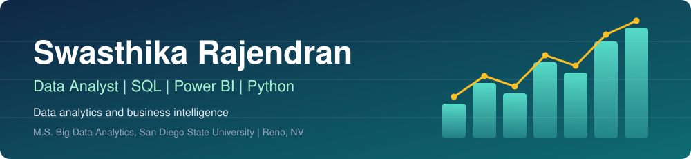
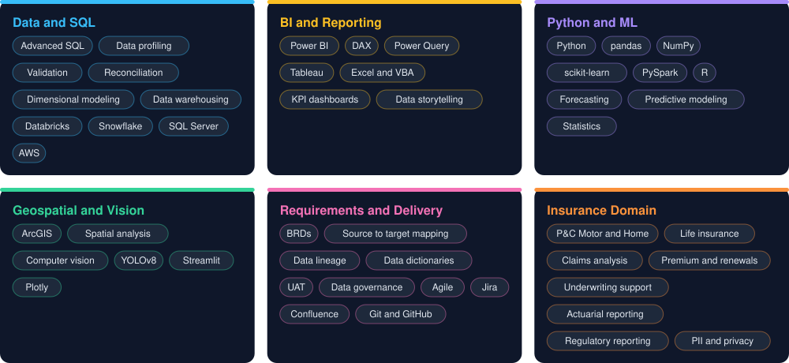

 

 

 

## About me

I turn policy, claims and street level data into clear reports and decisions. I have 10+ years of experience across insurance and business intelligence, and I am finishing my M.S. in Big Data Analytics at San Diego State University in December 2026.

| Focus | What I do |
| :--- | :--- |
| **Data Analytics** | Policy, claims and premium reporting, data validation, requirements and source to target mapping |
| **Dashboards** | Power BI, Tableau, Excel and Streamlit |

 

## Skills

 

## Career timeline

| Years | Role | Focus |
| :--- | :--- | :--- |
| 2025 to now | Graduate Research Assistant, SDSU MOCL Lab | Research, geospatial analysis, dashboards |
| 2019 to 2022 | Assistant Manager, Data Analytics and MIS, TATA AIA Life Insurance | Power BI, requirements, SQL, Team of 4 |
| 2013 to 2019 | Business Intelligence Analyst, RKC (Bharti Airtel) | SQL, KPI dashboards, report automation |
| 2011 to 2013 | Administrator, Royal Bank of Scotland | Banking, reconciliation |

 

**Open to AI/ML Roles.**

[Connect with me on LinkedIn](https://linkedin.com/in/swasthika-rajendran)

